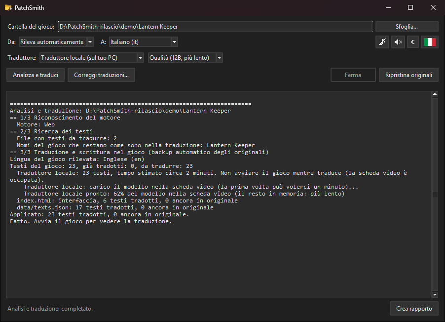

# PatchSmith (v0.1.0)

*English: [README.md](README.md). Tutti i dettagli tecnici (motore per motore, controlli, riga di comando, prove): [docs/TECNICO.md](docs/TECNICO.md) (in inglese: [docs/TECHNICAL.md](docs/TECHNICAL.md)).*

*Il fabbro delle patch per i videogiochi: oggi traduzioni native, domani risoluzioni e configurazioni.*

PatchSmith traduce automaticamente i testi di un videogioco **dentro il gioco stesso**, come una localizzazione ufficiale: niente overlay, sia i dati del gioco sia i menu. È gratuito, funziona anche senza internet con un traduttore che gira sul tuo PC e fa sempre una copia di sicurezza dei file originali: con un clic torna tutto com'era.

Cosa fa:
- riconosce il motore del gioco;
- trova da solo dove sono i testi;
- li traduce (di default con il traduttore locale sul tuo PC: niente account, nessun limite);
- li scrive nel gioco, con la copia di sicurezza di ogni file che cambia.

Solo per Windows. L'interfaccia è in italiano e in inglese (si cambia con la bandierina).

## Scarica e avvia

1. Scarica `PatchSmith-0.1.0-windows.zip` dalla [pagina delle Release](https://github.com/shottocode/PatchSmith/releases) ed estrailo dove vuoi (Python è incluso: niente da installare).
2. Fai doppio clic su **`PatchSmith.exe`**.
3. **Sfoglia…**: scegli la cartella del gioco (quella con il suo eseguibile).
4. Lascia **Da** su "Rileva automaticamente" e **A** sulla tua lingua, poi premi **Analizza e traduci**.
5. Avvia il gioco.

**Ripristina originali** rimette i file originali, identici byte per byte; le traduzioni restano salvate, quindi **Analizza e traduci** le rimette in un attimo. **Correggi traduzioni…** elenca tutte le righe tradotte, con quelle da guardare (rimaste in originale, troppo lunghe, sospette), e scrive le tue correzioni nel gioco. **Crea rapporto** prepara uno zip da inviare a chi ti aiuta (senza la chiave DeepL né l'email).

Dal sorgente serve **Python 3.10+** con Tkinter (nessun'altra libreria): avvia `PatchSmith.pyw`, oppure `python -I smith.py gui`; `python -I smith.py -h` elenca i comandi della riga di comando (per esempio `python -I smith.py auto "D:\giochi\MioGioco"`).

## Giochi supportati

| Motore | Stato |
|---|---|
| Unity (Mono, 32/64 bit) | **Supportato**: installa e configura BepInEx + XUnity.AutoTranslator, che traducono i testi dentro il gioco mentre giochi. Provato su Rubinite (Unity 6) |
| Unity con Unity Localization (anche IL2CPP) | **Supportato**: traduce le tabelle dei testi dentro i loro bundle, anche con il catalogo che controlla le impronte o binario. Provato su SWORN e Big Dig |
| Unreal Engine 4 (pak non cifrati) | **Supportato**: i `.locres` tradotti in un nuovo pak di patch; i pak del gioco non si toccano. Provato su Dungeon Defenders: Awakened |
| GameMaker con file di localizzazione esterni | **Supportato**: file a righe, dizionari JSON per lingua, tabelle CSV. Provato su Dokimon, Forager, Another Door, Megaloot |
| XNA / FNA / MonoGame con risorse .NET localizzate | **Supportato**: aggiunge i file di lingua .NET tradotti. Provato su Rogue Legacy |
| Godot 4 con le tabelle delle traduzioni | **Supportato** senza toccare i file del gioco (`override.cfg` e un piccolo script). Provato su You Know The Drill |
| Electron / NW.js / HTML5 | **Supportato**: dati JSON e menu. Provato su Sudoku Mansion |
| Giochi web con i file cifrati (es. GemShell) | **Tradotti mentre giochi**, se il gioco ha un `preload.js` leggibile. Il file cifrato non si apre mai. Provato su Now That's a Big Dragon |
| RPG Maker MV/MZ | Sperimentale, dopo averti chiesto |
| Unity IL2CPP senza Unity Localization, Unreal 5 / IoStore / pak cifrati, GameMaker con i testi nel codice (`data.win`), Godot 3, Ren'Py, KiriKiri, Wolf | Riconosciuti, non ancora supportati |

La traduzione automatica non ha contesto: la qualità è quella di una traduzione automatica.

## Traduttori

| Traduttore | Cosa serve | Limite |
|---|---|---|
| **Traduttore locale** (predefinito, consigliato) | Un'installazione una tantum, dopo il tuo sì: Ollama e un modello TranslateGemma di Google (4B: 3,3 GB; 12B: 8,1 GB). Meglio con una scheda video NVIDIA. Gira sul tuo PC e funziona anche senza internet | **Nessuno** |
| **DeepL** | La tua chiave gratuita "DeepL API Free" (deepl.com/pro-api); **Verifica** la prova subito | 500.000 caratteri al mese |
| **MyMemory** | Niente; la tua email (facoltativa) alza il limite | 5.000 caratteri al giorno, 50.000 con l'email |
| **Google gratuito (non ufficiale)** | Niente | Non dichiarato: Google blocca spesso queste richieste. PatchSmith allora si mette in pausa, tiene quello che ha tradotto e riparte da lì con un altro traduttore |

## Sicurezza

- Ogni file che PatchSmith cambia viene prima copiato; **Ripristina originali** rimette file identici e toglie tutto quello che ha aggiunto (i file che hai modificato a mano restano). Dove può, PatchSmith *aggiunge* soltanto file e lascia intatti quelli del gioco.
- Prima di partire controlla che il gioco sia chiuso, che nella cartella si possa scrivere, che ci sia spazio sul disco e che il traduttore sia pronto.
- Dopo che hai giocato guarda cosa è successo (crash, file rimessi da un aggiornamento del gioco, lettere che i font del gioco non sanno disegnare) e corregge da solo quello che si può correggere in sicurezza.
- Le lettere che i font del gioco non hanno diventano le più simili, e le etichette che non ci starebbero si chiedono più corte al traduttore locale.

## Inoltre

- **Traduzione mentre giochi** (giochi Unity e giochi web dal vivo, a scelta): le frasi nuove si traducono quando compaiono; un pulsante la ferma.
- Tema chiaro o scuro (come Windows finché non scegli tu), suoni e musica di sottofondo in stile 8 bit, a scelta (spenti di default).

## Pacchetto da pubblicare

`python -I smith.py pacchetto` prepara `PatchSmith-rilascio/PatchSmith` e `PatchSmith-<versione>-windows.zip` accanto alla cartella del programma: il programma, `PatchSmith.exe` e un Python portatile (con Tkinter) isolato dal resto del PC. `--python <cartella>` usa un altro Python (consigliato il più recente da python.org). Le prove: `python -I test/esegui_tutto.py` (usano giochi e traduttori finti, mai i tuoi dati veri). Dettagli in [docs/TECNICO.md](docs/TECNICO.md).

## Contatti

- **Problemi o proposte:** apri una segnalazione nelle [Issues](https://github.com/shottocode/PatchSmith/issues), anche in italiano. Allega lo zip di **Crea rapporto**: non contiene la chiave DeepL né l'email.
- **Domande e idee:** [Discussions](https://github.com/shottocode/PatchSmith/discussions).
- **Problemi di sicurezza:** in privato, con [Report a vulnerability](https://github.com/shottocode/PatchSmith/security/advisories/new).

## Note legali

- Usa PatchSmith solo su copie legittime, per uso personale.
- Se condividi una traduzione, condividi solo la memoria delle traduzioni di PatchSmith (`memory/*.json`) e il profilo, mai i file del gioco.
- Non usarlo su giochi online o con anti-cheat.
- L'endpoint gratuito di Google non è un servizio ufficiale.
- I modelli TranslateGemma sono di Google e si usano secondo i Gemma Terms of Use (ai.google.dev/gemma/terms), che si accettano scaricandoli.

## Licenza e crediti

PatchSmith è distribuito con la [licenza MIT](LICENSE). I componenti di altri mantengono le loro licenze:
- regole di rilevamento dei motori: [SteamDB FileDetectionRuleSets](https://github.com/SteamDatabase/FileDetectionRuleSets) (MIT, licenza in `data/`);
- giochi Unity: [BepInEx](https://github.com/BepInEx/BepInEx) (LGPL-2.1) e [XUnity.AutoTranslator](https://github.com/bbepis/XUnity.AutoTranslator) (MIT), scaricati quando servono;
- traduttore locale: [Ollama](https://github.com/ollama/ollama) (MIT) e [TranslateGemma](https://ollama.com/library/translategemma) di Google (Gemma Terms of Use), scaricati quando servono;
- il pacchetto pubblicato contiene un [Python](https://www.python.org) portatile (licenza PSF, in `runtime/LICENSE.txt`).
