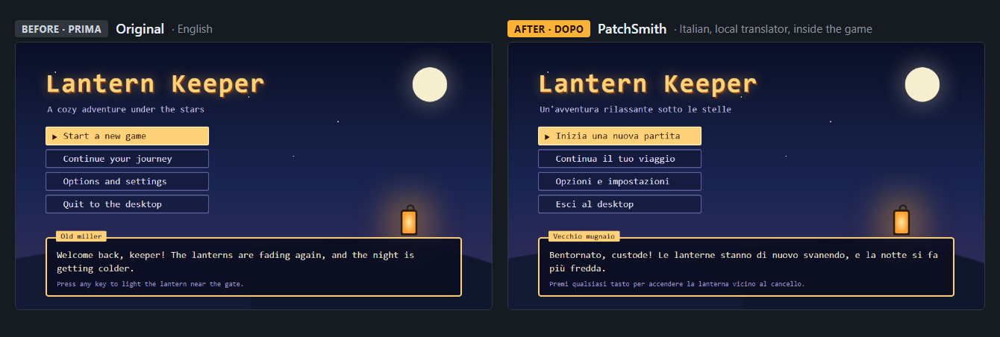
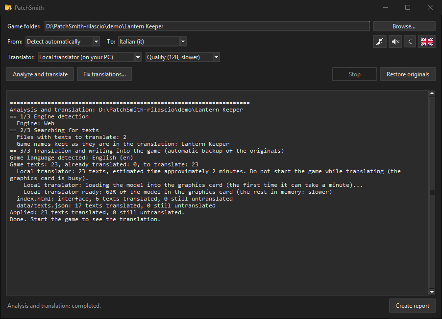

# PatchSmith (v0.1.0)

*Italiano: [LEGGIMI.md](LEGGIMI.md). All the technical details (engine by engine, checks, command line, tests): [docs/TECHNICAL.md](docs/TECHNICAL.md).*

*A patch smith for video games: native translations today, resolutions and settings tomorrow.*

PatchSmith automatically translates a video game's text **inside the game itself**, like an official localization: no overlays, both the game's data and its menus. It is free, it works offline with a translator that runs on your PC, and it always keeps a backup of the original files: one click puts everything back.

What it does:
- recognizes the game's engine;
- finds the text on its own;
- translates it (by default with a local translator on your PC: no account, no limits);
- writes it into the game, with a backup of every file it changes.

Windows only. The interface is in Italian and English (the flag button switches it).

## Download and start

1. Download `PatchSmith-0.1.0-windows.zip` from the [Releases page](https://github.com/shottocode/PatchSmith/releases) and extract it anywhere (Python is included: nothing to install).
2. Double-click **`PatchSmith.exe`**. The first time, Windows may show **"Windows protected your PC"**: PatchSmith is free and its executable is not signed with a paid certificate, so Windows does not know it yet. Click **More info**, then **Run anyway**. The code is all here on GitHub, and the release page shows the SHA-256 of the zip to check that it is the original one.
3. **Browse…**: choose the game's folder (the one with its executable).
4. Leave **From** on "Detect automatically" and **To** on your language, then press **Analyze and translate**.
5. Start the game.

**Restore originals** puts back the original files, byte for byte; your translations stay saved, so **Analyze and translate** brings them back in a moment. **Fix translations…** lists every translated line, with the ones worth checking (left untranslated, too long, suspicious), and writes your corrections into the game. **Create report** makes a zip to send to whoever helps you (without your DeepL key or email).

From source: you need **Python 3.10+** with Tkinter (no other libraries). Run `PatchSmith.pyw`, or `python -I smith.py gui`; `python -I smith.py -h` lists the command-line commands (for example `python -I smith.py auto "D:\Games\MyGame"`).

## Supported games

| Engine | Status |
|---|---|
| Unity (Mono, 32/64-bit) | **Supported**: installs and configures BepInEx + XUnity.AutoTranslator, which translate the text inside the game while you play. Tested on Rubinite (Unity 6) |
| Unity with Unity Localization (also IL2CPP) | **Supported**: translates the string tables inside their bundles, even with a checksummed or binary catalog. Tested on SWORN and Big Dig |
| Unreal Engine 4 (unencrypted paks) | **Supported**: translated `.locres` files in a new patch pak; the game's paks are not touched. Tested on Dungeon Defenders: Awakened |
| GameMaker with external localization files | **Supported**: line files, per-language JSON dictionaries, CSV tables. Tested on Dokimon, Forager, Another Door, Megaloot |
| XNA / FNA / MonoGame with localized .NET resources | **Supported**: adds translated satellite assemblies. Tested on Rogue Legacy |
| Godot 4 with translation tables | **Supported** without touching the game's files (`override.cfg` and a small script). Tested on You Know The Drill |
| Electron / NW.js / HTML5 | **Supported**: JSON data and menus. Tested on Sudoku Mansion |
| Web games with encrypted files (e.g. GemShell) | **Translated while you play**, when the game has a readable `preload.js`. The encrypted file is never opened. Tested on Now That's a Big Dragon |
| RPG Maker MV/MZ | Experimental, after asking you |
| Unity IL2CPP without Unity Localization, Unreal 5 / IoStore / encrypted paks, GameMaker text compiled in `data.win`, Godot 3, Ren'Py, KiriKiri, Wolf | Detected, not supported yet |

Machine translation has no context: expect machine-translation quality.

## Translators

| Translator | What it needs | Limit |
|---|---|---|
| **Local translator** (default, recommended) | A one-time install, on your confirmation: Ollama and a Google TranslateGemma model (4B: 3.3 GB, 12B: 8.1 GB). Best with an NVIDIA graphics card. It runs on your PC and works offline | **None** |
| **DeepL** | Your free "DeepL API Free" key (deepl.com/pro-api); **Check** tests it right away | 500,000 characters a month |
| **MyMemory** | Nothing; your email (optional) raises the limit | 5,000 characters a day, 50,000 with an email |
| **Google free (unofficial)** | Nothing | Not stated: Google often blocks these requests. PatchSmith then pauses, keeps what it has translated and resumes from there with another translator |

## Safety

- Every file PatchSmith changes is backed up first; **Restore originals** puts back identical files and removes everything it added (files you edited by hand are kept). Where it can, PatchSmith only *adds* files and leaves the game's own files untouched.
- Before starting it checks that the game is closed, that the folder is writable, that there is enough disk space and that the translator is ready.
- After you play, it looks at what happened (crashes, files restored by a game update, letters the game's fonts cannot draw) and fixes what it can fix safely.
- Letters the game's fonts lack are replaced with the closest ones, and labels that would not fit are asked shorter from the local translator.

## Also

- **Translation while you play** (Unity and live web games, optional): new lines are translated as they appear; a button stops it.
- Light or dark theme (following Windows until you choose), optional 8-bit sounds and background music (off by default).

## Building the release

The zip of each release is built by GitHub Actions ([.github/workflows/release.yml](.github/workflows/release.yml)) from the code of the repository, when a version tag is pushed. Anyone can check that a downloaded zip comes from there: `gh attestation verify PatchSmith-<version>-windows.zip -R shottocode/PatchSmith`.

`python -I smith.py package` builds `PatchSmith-rilascio/PatchSmith` and `PatchSmith-<version>-windows.zip` next to the program folder: the program, `PatchSmith.exe` and a portable Python (with Tkinter) isolated from the rest of the PC. `--python <folder>` uses another Python (the latest one from python.org is recommended). The tests: `python -I test/run_all.py` (they use fake games and translators, never your real data).

## Contact

- **Problems or suggestions:** open an [issue](https://github.com/shottocode/PatchSmith/issues), in English or Italian. Attach the **Create report** zip: it does not contain your DeepL key or email.
- **Questions and ideas:** [Discussions](https://github.com/shottocode/PatchSmith/discussions).
- **Security problems:** privately, with [Report a vulnerability](https://github.com/shottocode/PatchSmith/security/advisories/new).
- **Contributing:** see [CONTRIBUTING.md](CONTRIBUTING.md). The code and the saved data are in English.

## Legal notes

- Use it only on legitimate copies, for personal use.
- If you share a translation, share only PatchSmith's translation memory (`memory/*.json`) and profile, never the game's files.
- Do not use it on online games or games with anti-cheat.
- The free Google endpoint is not an official service.
- The TranslateGemma models belong to Google and are used under the Gemma Terms of Use (ai.google.dev/gemma/terms), accepted when you download them.

## License and credits

PatchSmith is released under the [MIT License](LICENSE). Third-party components keep their own licenses:
- engine detection rules: [SteamDB FileDetectionRuleSets](https://github.com/SteamDatabase/FileDetectionRuleSets) (MIT, license in `data/`);
- Unity games: [BepInEx](https://github.com/BepInEx/BepInEx) (LGPL-2.1) and [XUnity.AutoTranslator](https://github.com/bbepis/XUnity.AutoTranslator) (MIT), downloaded when needed;
- local translator: [Ollama](https://github.com/ollama/ollama) (MIT) and [TranslateGemma](https://ollama.com/library/translategemma) by Google (Gemma Terms of Use), downloaded when needed;
- the release includes a portable [Python](https://www.python.org) (PSF License, in `runtime/LICENSE.txt`).
